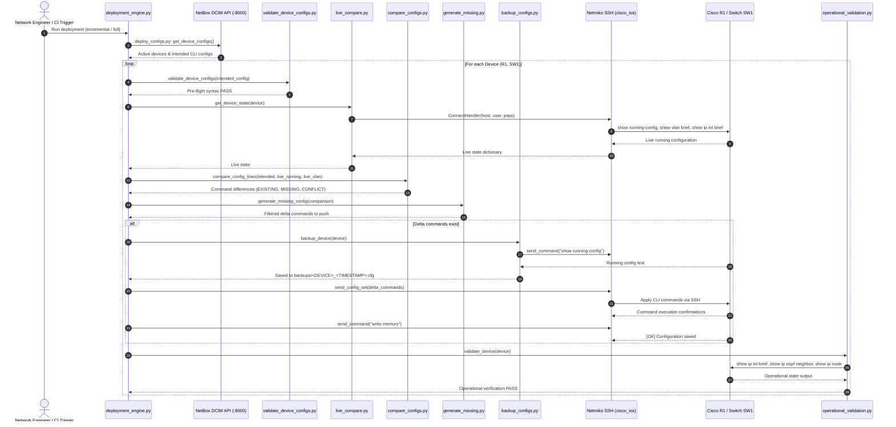
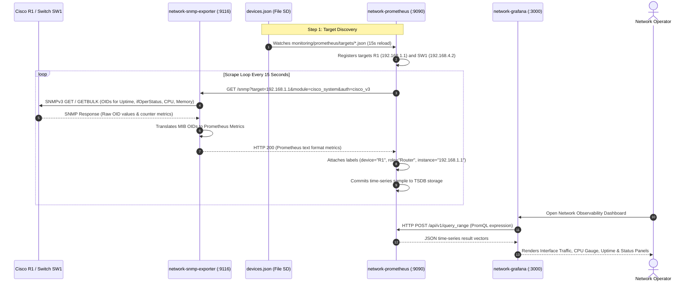

# End-to-End Architectural Call Flows Reference

This document provides a comprehensive, step-by-step breakdown of every file, function call, and payload transformation across the three core operational pipelines in this project:

1. **CI/CD Configuration Deployment Pipeline** (NetBox &rarr; Pre-flight &rarr; Diff &rarr; Backup &rarr; Netmiko &rarr; Devices)
2. **Telemetry & Observability Pipeline** (Devices &rarr; SNMP Exporter &rarr; Prometheus &rarr; Grafana)
3. **Automated Incident Ticketing Pipeline** (Devices &rarr; Prometheus Alert Rules &rarr; Alertmanager &rarr; NetBox SSoT &rarr; Jira Service Management)

---

# SECTION 1: CI/CD Deployment Call Flow (NetBox &rarr; Devices)

### High-Level Sequence Diagram



---

### Step-by-Step File & Function Execution Chain

| Step | File Name | Function Called | Input Data | Output / Action |
| :--- | :--- | :--- | :--- | :--- |
| **1. Trigger** | `.github/workflows/network-ci.yml` | `pytest` / manual dispatch | Git commit or CLI trigger | Executes CI compilation (`compileall`), linting (`pyflakes`), and unit tests. |
| **2. Inventory Fetch** | `src/netbox/get_devices.py` | `get_devices()` | NetBox URL & Token from `.env` | Queries `GET /api/dcim/devices/?status=active`. Extracts device names, primary IPs, and roles. |
| **3. Config Retrieval** | `src/network/deploy_configs.py` | `get_device_configs()` | `NETBOX_URL`, `NETBOX_TOKEN` | Queries NetBox device configuration context (`custom_fields` or `local_context_data.cli_config`). |
| **4. Pre-Flight Validation** | `src/network/validate_device_configs.py` | `validate_device_configs()` | Raw intended CLI text | Passes intended CLI text through parsers and validators: |
| | &bull; `src/network/config_parser.py` | `parse_cisco_config()` | Intended config text | Builds hierarchical AST / dictionary of global commands, interfaces, VLANs, and DHCP pools. |
| | &bull; `src/network/validators/vlan.py` | `validate_vlans()` | Parsed VLANs list | Validates VLAN IDs are strictly within 1–4094; detects duplicate names or IDs. |
| | &bull; `src/network/validators/dhcp.py` | `validate_dhcp_pools()` | Parsed DHCP pools | Validates subnet masks, default routers, and exclusion boundaries. |
| **5. Live State Pull** | `src/network/live_compare.py` | `get_device_state(device)` | Device IP + SSH credentials from `.env` | Connects via Netmiko SSH (`cisco_ios`). Executes: <br>&bull; `show running-config`<br>&bull; `show vlan brief`<br>&bull; `show ip interface brief` |
| **6. Comparison & Diffing** | `src/network/compare_configs.py` | `compare_config_lines()` | Intended config vs live running config | Line-by-line comparison with context awareness. Classifies every command as `EXISTING`, `MISSING`, or `CONFLICT`. |
| **7. Delta Generation** | `src/network/generate_missing.py` | `generate_missing_config()` | Comparison result list | Filters out session commands (`conf t`, `exit`, `write`). Properly indents child commands under parent blocks (`interface`, `ip dhcp pool`). If `CONFLICT` exists, halts deployment safely. |
| **8. Pre-Deploy Backup** | `src/network/backup_configs.py` | `backup_device(device)` | Device credentials & IP | Connects over Netmiko SSH, executes `show running-config`, and writes timestamped backup to `backups/<DEVICE>_<TIMESTAMP>.cfg`. |
| **9. Configuration Push** | `src/network/deployment_engine.py` | `deploy_device(plan)` | Delta commands list | Pushes commands using Netmiko `send_config_set()`. Executes `write memory` to save to startup-config. |
| **10. Operational Validation** | `src/network/operational_validation.py` | `validate_device(device)` | Device credentials & IP | Executes read-only operational commands (`show ip interface brief`, `show ip ospf neighbor`, `show ip route`) to verify network convergence. |

---

# SECTION 2: Telemetry Flow (Network Devices &rarr; Prometheus &rarr; Grafana)

### High-Level Sequence Diagram



---

### Step-by-Step File & Infrastructure Call Chain

| Stage | Component / File | Configuration Key / Function | Data Transformed & Transferred |
| :--- | :--- | :--- | :--- |
| **1. Dynamic Target Definition** | `monitoring/prometheus/targets/devices.json` | `file_sd_configs` | Defines targets (`192.168.1.1`, `192.168.4.2`) and metadata labels (`device="R1"`, `role="Router"`). Can also be dynamically exported from NetBox via `src/observability/discovery.py`. |
| **2. Scrape Configuration** | `monitoring/prometheus/prometheus.yml` | `job_name: "cisco_snmp"` | Configured with `scrape_interval: 15s`. Uses relabeling rules to rewrite `__address__` to `snmp-exporter:9116` while preserving the device IP in `__param_target`. |
| **3. SNMP Translation** | `monitoring/snmp-exporter/snmp.yml` | `module: cisco_system`, `auth: cisco_v3` | Listens on port `9116`. Translates SNMPv3 requests into OID walks: <br>&bull; `1.3.6.1.2.1.1.3` &rarr; `sysUpTime`<br>&bull; `1.3.6.1.2.1.2.2.1.8` &rarr; `ifOperStatus`<br>&bull; `1.3.6.1.2.1.31.1.1.1.6/10` &rarr; `ifHCInOctets` / `ifHCOutOctets`<br>&bull; `1.3.6.1.4.1.9.9.109.1.1.1.1.5` &rarr; `cpmCPUTotal5min`<br>&bull; `1.3.6.1.4.1.9.9.48.1.1.1.5/6` &rarr; `ciscoMemoryPoolUsed` / `Free` |
| **4. Raw SNMP Polling** | Physical / Virtual Network Devices (R1, SW1) | SNMPv3 Agent (`authPriv`) | Responds to SNMP Exporter with raw octets, gauge states (e.g., `1` for Up, `2` for Down), and interface indexes. |
| **5. TSDB Storage** | `network-prometheus` container | `storage.tsdb.path: /prometheus` | Ingests metric vectors, applies relabeling (`instance="192.168.1.1"`, `device="R1"`), and stores time-series data with 15-day retention. |
| **6. Datasource Provisioning** | `monitoring/grafana/provisioning/datasources/prometheus.yml` | `url: http://prometheus:9090` | Connects Grafana automatically to Prometheus container over the Docker internal network. |
| **7. Dashboard Rendering** | `monitoring/grafana/dashboards/network_observability.json` | Panels & PromQL Queries | Renders live data using PromQL queries: <br>&bull; **Availability**: `up{job="cisco_snmp"}`<br>&bull; **Uptime**: `sysUpTime / 100`<br>&bull; **Interface Status**: `ifOperStatus * on(instance, ifIndex) group_left(ifDescr) (ifDescr > 0)`<br>&bull; **Traffic (bps)**: `rate(ifHCInOctets[2m]) * 8`<br>&bull; **CPU Utilization**: `cpmCPUTotal5min` |

---

# SECTION 3: Automated Incident Ticketing Flow (Devices &rarr; Prometheus &rarr; Jira)

### High-Level Sequence Diagram

```mermaid
sequenceDiagram
    autonumber
    participant Router as Cisco R1 / Switch SW1
    participant Prom as Prometheus (:9090)
    participant AM as Alertmanager (:9093)
    participant Gateway as webhook_gateway.py (:5050)
    participant NetBox as NetBox DCIM API (:8000)
    participant TM as ticket_manager.py
    participant Disc as discovery.py
    participant Client as client.py (JiraClient)
    participant Jira as Jira Cloud (netkode.atlassian.net)

    Note over Router,Prom: Phase 1: Anomaly Detection
    Router->>Router: Interface drops (e.g. FastEthernet0/0 goes down)
    Prom->>Router: Periodic SNMP Poll detects ifOperStatus == 2
    Prom->>Prom: Evaluates alert_rules.yml (condition holds for 30s)
    Prom->>AM: POST /api/v2/alerts (State: firing, alertname="NetworkInterfaceDown")

    Note over AM,Gateway: Phase 2: Dampening & Dispatch
    AM->>AM: Groups by [device, ifDescr], applies group_wait (10s)
    AM->>Gateway: POST /api/v1/alerts (JSON Webhook Payload)

    Note over Gateway,NetBox: Phase 3: Dynamic SSoT Validation (Zero Spam)
    Gateway->>NetBox: NetBoxValidator.is_interface_monitored("R1", "FastEthernet0/0")
    NetBox-->>Gateway: HTTP 200 (enabled=True, count=1)
    Note right of Gateway: Interface is in NetBox SSoT -> Proceed

    Note over Gateway,Jira: Phase 4: Ticketing & Duplicate Prevention
    Gateway->>TM: process_network_alert(NetworkIncident)
    TM->>TM: Generate Fingerprint: network-incident:R1:NETWORKINTERFACEDOWN:FASTETHERNET0/0
    TM->>Client: search_issues(JQL: project="OPS" AND description ~ fingerprint)
    Client->>Jira: POST /rest/api/3/search/jql
    Jira-->>Client: No active ticket found

    TM->>Disc: discover_incident_metadata()
    Disc-->>TM: ServiceDesk=1, RequestType=8, Urgency=customfield_10050
    TM->>Client: create_customer_request(serviceDeskId=1, requestTypeId=8, fields)
    Client->>Jira: POST /rest/servicedeskapi/request
    Jira-->>Client: Ticket Created: OPS-25 (Status: Open)
    Client-->>TM-->>Gateway: Success: Created OPS-25

    Note over Router,Jira: Phase 5: Link Recovery & Auto-Resolution
    Router->>Router: Link restored (interface up)
    Prom->>Prom: ifOperStatus returns to 1 (Alert clears)
    Prom->>AM: Alert state -> resolved
    AM->>Gateway: POST /api/v1/alerts (Status: resolved)
    Gateway->>TM: resolve_ticket("OPS-25", comment="Prometheus: Link restored")
    TM->>Client: transition_issue("OPS-25", transition_id=111)
    Client->>Jira: POST /rest/api/3/issue/OPS-25/transitions (Resolve -> Completed)
    Jira-->>Client: Ticket OPS-25 transitioned to Completed
    Client-->>Gateway: Auto-resolution complete
```

---

### Step-by-Step File & Function Execution Chain

| Step | File Name | Function / Hook | Operational Action |
| :--- | :--- | :--- | :--- |
| **1. Anomaly Detection** | Router / Switch | Hardware event | Physical cable disconnection or port flap causes Cisco IOS to mark interface state down (`ifOperStatus = 2`). |
| **2. Scrape & Evaluation** | `monitoring/prometheus/alert_rules.yml` | `alert: NetworkInterfaceDown` | PromQL evaluation: <br>`(ifOperStatus{job="cisco_snmp"} == 2) * on(instance, ifIndex) group_left(ifDescr) (ifDescr > 0)`<br>Requires condition to persist for `30s` (flap suppression). |
| **3. Prometheus Alerting** | `monitoring/prometheus/prometheus.yml` | `alerting.alertmanagers` | Routes alert payload to `network-alertmanager:9093`. |
| **4. Alert Grouping** | `monitoring/alertmanager/alertmanager.yml` | `route.receiver: 'jira-webhook-gateway'` | Groups alerts by `[alertname, device, ifDescr]`. Waits `10s` (`group_wait`) to coalesce multi-port events. Sends webhook to `http://alert-gateway:5050/api/v1/alerts` with `send_resolved: true`. |
| **5. Webhook Ingestion** | `integrations/jira/webhook_gateway.py` | `AlertmanagerHTTPRequestHandler.do_POST()` | Listens on port `5050`. Parses Alertmanager JSON schema. Dispatches to `JiraAlertProcessor.process_alertmanager_payload()`. |
| **6. NetBox SSoT Filter** | `integrations/jira/netbox_validator.py` | `NetBoxValidator.is_interface_monitored()` | **Zero Hardcoding**: Queries NetBox REST API `GET /api/dcim/interfaces/?device=<DEV>&name=<IF>`. <br>&bull; If NOT in NetBox (e.g. `Serial2/3`) &rarr; **SKIPPED (0 tickets created)**.<br>&bull; If in NetBox & active (e.g. `FastEthernet0/0`) &rarr; **Proceeds to ticket creation**. |
| **7. Incident Normalization** | `integrations/jira/ticket_manager.py` | `NetworkIncident` dataclass | Normalizes alert into device name, alert severity, device IP, interface telemetry, and computes the deterministic fingerprint: `network-incident:<DEVICE>:<ALERT>:<INTERFACE>`. |
| **8. Duplicate Prevention Check**| `integrations/jira/ticket_manager.py` | `find_active_incident()` | Executes real-time JQL directly on Jira Cloud: `project = "OPS" AND statusCategory != Done AND description ~ "<FINGERPRINT>"`. |
| **9. Deduplication Routing** | `integrations/jira/ticket_manager.py` | `process_network_alert()` | &bull; **If active ticket exists**: Appends an operational telemetry update comment (`add_ticket_comment`). Blocks duplicate ticket creation.<br>&bull; **If no active ticket exists**: Calls `create_incident_ticket()`. |
| **10. Dynamic Schema Discovery** | `integrations/jira/discovery.py` | `discover_incident_metadata()` | Dynamically discovers Project ID (`10000`), Service Desk ID (`1`), Request Type ID (`8`), and schema field keys for Urgency and Impact (`customfield_10050`, `customfield_10004`). |
| **11. Customer Request Creation** | `integrations/jira/client.py` | `create_customer_request()` | Sends authenticated POST to `/rest/servicedeskapi/request` creating ticket (e.g. `OPS-25`) in Jira Cloud under Project `OPS`. |
| **12. Auto-Resolution on Recovery** | `integrations/jira/webhook_gateway.py` | `_handle_resolved_alert()` | When the interface recovers, Alertmanager dispatches `status: "resolved"`. Gateway finds `OPS-25`, discovers workflow transition ID `111` (`Resolve` &rarr; `Completed`), and closes the ticket automatically. |

---

### Complete System File Map

```
network-automation-cicd/
│
├── .github/workflows/
│   └── network-ci.yml                      # CI/CD GitHub Actions Workflow
│
├── src/
│   ├── netbox/
│   │   └── get_devices.py                  # Dynamic device inventory from NetBox API
│   │
│   ├── network/
│   │   ├── deploy_configs.py               # Pulls intended CLI configs from NetBox
│   │   ├── validate_device_configs.py      # Pre-flight syntax validation runner
│   │   ├── config_parser.py                # Cisco CLI hierarchical parser
│   │   ├── live_compare.py                 # Live device state pull via Netmiko SSH
│   │   ├── compare_configs.py              # Context-aware diffing engine
│   │   ├── generate_missing.py             # Delta / remediation command generator
│   │   ├── backup_configs.py               # Pre-deployment backup engine
│   │   ├── deployment_engine.py            # Netmiko push & rollback orchestrator
│   │   ├── operational_validation.py       # Post-deployment live operational checks
│   │   └── validators/                     # Modular syntax validators (VLAN, DHCP)
│   │
│   └── observability/
│       ├── discovery.py                    # Exports NetBox devices to Prometheus File SD
│       ├── prometheus_client.py            # Low-level Prometheus REST querying client
│       ├── metrics_collector.py            # Collects 10 operational parameters
│       ├── health_checker.py               # Health evaluation & threshold matrix
│       └── pipeline.py                     # Post-deployment observability verification hook
│
├── monitoring/
│   ├── snmp-exporter/
│   │   └── snmp.yml                        # SNMPv3 OID mappings (Cisco system MIB)
│   ├── prometheus/
│   │   ├── prometheus.yml                  # Prometheus scrape & alerting configs
│   │   ├── alert_rules.yml                 # PromQL alert rules (InterfaceDown, etc.)
│   │   └── targets/devices.json            # Dynamic target inventory for Prometheus
│   ├── alertmanager/
│   │   └── alertmanager.yml                # Alert grouping & webhook routing to port 5050
│   └── grafana/
│       ├── provisioning/                   # Automated datasource & dashboard providers
│       └── dashboards/
│           └── network_observability.json  # Pre-built Grafana monitoring dashboard
│
└── integrations/jira/
    ├── config.py                           # .env credentials loader & token redaction
    ├── client.py                           # Jira REST API client (Basic Auth, error handling)
    ├── discovery.py                        # Dynamic discovery of Service Desk & Field IDs
    ├── issue_manager.py                    # Comments, updates, and workflow transitions
    ├── ticket_manager.py                   # NetworkIncident dataclass & deduplication logic
    ├── netbox_validator.py                 # Dynamic NetBox SSoT interface validator
    ├── webhook_gateway.py                  # Prometheus Alertmanager Webhook Gateway daemon
    ├── demo_incident.py                    # Standalone incident lifecycle demo
    └── verify_live_alert.py                # End-to-end Alertmanager simulation script
```

