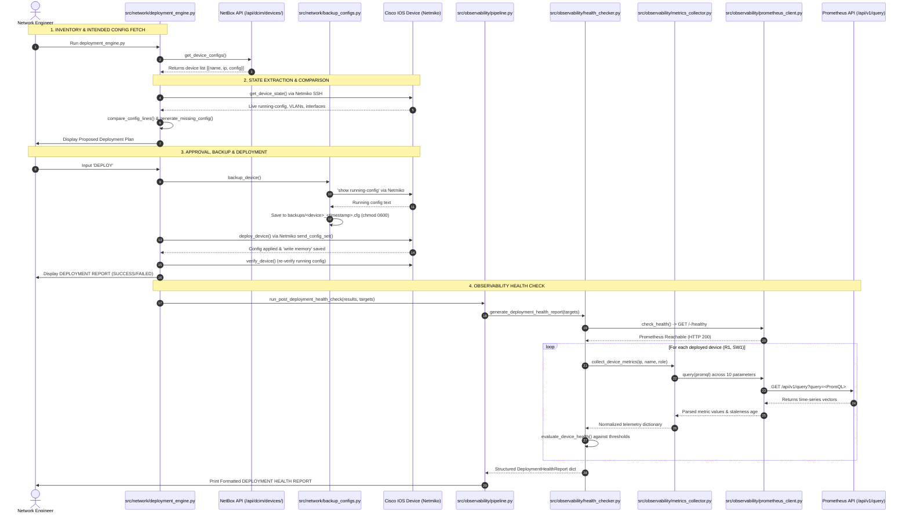

# Network CI/CD & Observability: Stage-by-Stage Calling Reference

This document provides a technical walkthrough of every execution stage, showing how functions are called, how data is passed between modules from NetBox to Observability, and how errors are handled.

---

## 1. End-to-End Sequence Diagram



---

## 2. Stage-by-Stage Technical Reference

### Stage 1: Dynamic Discovery & Inventory Query
- **Module**: [`src/netbox/get_devices.py`](file:///home/sivananda/network-automation-cicd/src/netbox/get_devices.py) & [`src/network/deploy_configs.py`](file:///home/sivananda/network-automation-cicd/src/network/deploy_configs.py)
- **Trigger**: Called by `deployment_engine.py` or `src/observability/discovery.py`.
- **API Call**: `GET {NETBOX_URL}/api/dcim/devices/?status=active&site_id={NETBOX_SITE_ID}`
- **Data Contract Returned**:
  ```python
  [
      {
          "name": "R1",
          "ip": "192.168.1.1",
          "role": "Router",
          "status": "Active",
          "config": "hostname R1\ninterface FastEthernet0/0\n..."
      },
      ...
  ]
  ```
- **Failure Handling**: If NetBox is unreachable, raises `RuntimeError` or connection warning with details.

---

### Stage 2: Dynamic Prometheus Target File Generation
- **Module**: [`src/observability/discovery.py`](file:///home/sivananda/network-automation-cicd/src/observability/discovery.py)
- **Function**: `generate_prometheus_targets(devices, output_path)`
- **Output Written**: [`monitoring/prometheus/targets/devices.json`](file:///home/sivananda/network-automation-cicd/monitoring/prometheus/targets/devices.json)
- **File Format (`file_sd_configs`)**:
  ```json
  [
    {
      "targets": ["192.168.1.1"],
      "labels": {
        "device": "R1",
        "role": "Router",
        "status": "Active",
        "ip": "192.168.1.1"
      }
    }
  ]
  ```
- **Prometheus Behavior**: Prometheus watches this file via `file_sd_configs` and automatically updates scrape targets every 15 seconds without restarting.

---

### Stage 3: Live State Extraction & Configuration Diffing
- **Modules**:
  - [`src/network/live_compare.py`](file:///home/sivananda/network-automation-cicd/src/network/live_compare.py) -> `get_device_state(device)`
  - [`src/network/compare_configs.py`](file:///home/sivananda/network-automation-cicd/src/network/compare_configs.py) -> `compare_config_lines()`
  - [`src/network/generate_missing.py`](file:///home/sivananda/network-automation-cicd/src/network/generate_missing.py) -> `generate_missing_config()`
- **Process**:
  1. Opens read-only Netmiko SSH session to device IP.
  2. Runs `show running-config`, `show vlan brief`, and `show ip interface brief`.
  3. Context-aware parser diffs intended vs live configuration.
  4. Generates idempotent incremental CLI commands (e.g. `interface FastEthernet0/0`, `no shutdown`).
  5. Displays plan to operator and prompts: `Type DEPLOY to approve deployment`.

---

### Stage 4: Pre-Deployment Backup
- **Module**: [`src/network/backup_configs.py`](file:///home/sivananda/network-automation-cicd/src/network/backup_configs.py)
- **Function**: `backup_device(device_info)`
- **Process**:
  - Connects to device over Netmiko SSH.
  - Pulls live running configuration.
  - Writes securely to `backups/{safe_device_name}_{timestamp}.cfg`.
  - Sets Linux file permissions to `0600` (read/write only by owner).
- **Safety Gate**: If backup fails for any target, deployment immediately halts.

---

### Stage 5: Configuration Deployment & Verification
- **Module**: [`src/network/deployment_engine.py`](file:///home/sivananda/network-automation-cicd/src/network/deployment_engine.py)
- **Functions**: `deploy_device(plan)` and `verify_device(plan)`
- **Process**:
  - Connects over Netmiko SSH.
  - Sends configuration set (`send_config_set`).
  - Scans response for error patterns (`% Invalid input`, `% Incomplete command`, `% Ambiguous command`).
  - Executes `write memory` to save to startup-config.
  - Runs `verify_device()` to confirm live running config matches intended state.
  - Prints standard `DEPLOYMENT REPORT`.

---

### Stage 6: Observability Health Check Trigger
- **Module**: [`src/observability/pipeline.py`](file:///home/sivananda/network-automation-cicd/src/observability/pipeline.py)
- **Function**: `run_post_deployment_health_check(results, targets)`
- **Integration Hook in `deployment_engine.py`**:
  ```python
  if os.getenv("ENABLE_OBSERVABILITY_CHECK", "true").lower() in {"true", "1", "yes"}:
      try:
          from src.observability.pipeline import run_post_deployment_health_check
          run_post_deployment_health_check(results=results, targets=targets)
      except Exception as obs_err:
          print(f"\n[OBSERVABILITY WARNING] Health check integration failed: {obs_err}")
  ```
- **Fault-Tolerance**: If Prometheus is unreachable or slow, deployment status is completely preserved.

---

### Stage 7: Telemetry Collection Across 10 Parameters
- **Module**: [`src/observability/metrics_collector.py`](file:///home/sivananda/network-automation-cicd/src/observability/metrics_collector.py)
- **Function**: `collect_device_metrics(ip, name, role)`
- **Queries Executed against Prometheus**:
  1. **Availability**: `up{instance=~"$ip(:\\d+)?"}` (1 = UP, 0 = DOWN)
  2. **Uptime**: `sysUpTime{instance=~"$ip(:\\d+)?"} / 100` (evaluated against 600s reboot threshold)
  3. **CPU Utilization**: `cpmCPUTotal5min{instance=~"$ip(:\\d+)?"}` (75% warning, 90% critical)
  4. **Memory Utilization**: `(ciscoMemoryPoolUsed / (Used + Free)) * 100` (80% warning, 90% critical)
  5. **Interface Status**: `ifOperStatus` + `ifDescr` mapping
  6. **Interface Traffic**: `rate(ifHCInOctets[2m]) * 8` & `rate(ifHCOutOctets[2m]) * 8`
  7. **Bandwidth Utilization**: `(Traffic bps / (ifHighSpeed * 1M)) * 100`
  8. **Interface Errors**: `rate(ifInErrors[5m])` + `rate(ifOutErrors[5m])`
  9. **OSPF Neighbor Status**: `ospfNbrState` (8 = FULL)
  10. **Network Latency**: `scrape_duration_seconds * 1000` ms (500ms warning, 2000ms critical)

---

### Stage 8: Health Evaluation & Report Formatting
- **Modules**: [`src/observability/health_checker.py`](file:///home/sivananda/network-automation-cicd/src/observability/health_checker.py) & [`src/observability/report_formatter.py`](file:///home/sivananda/network-automation-cicd/src/observability/report_formatter.py)
- **Status Classification Rules**:
  - `CRITICAL`: Device unreachable (`up == 0`), or any metric exceeds critical threshold.
  - `WARNING`: Metric exceeds warning threshold, interface errors detected, recent reboot (< 10 min), or OSPF neighbor not in FULL state.
  - `HEALTHY`: All supported metrics within healthy thresholds.
  - `UNKNOWN`: Prometheus unreachable or target data missing.
  - `UNSUPPORTED`: Gracefully flags MIBs not exposed by specific hardware models (e.g., SW1 CPU/Memory) **without marking device as failed**.
- **Output**: Clean ASCII-bordered console report printed to terminal.

---

## 3. CLI Execution Cheat-Sheet

| Task | Command |
| :--- | :--- |
| **Run Full Test Suite** | `./venv/bin/pytest -v` |
| **Generate Prometheus Targets** | `./venv/bin/python -m src.observability.discovery` |
| **Run Full Deployment Pipeline** | `./venv/bin/python -m src.network.deployment_engine` |
| **Run Standalone Health Check** | `./venv/bin/python -m src.observability.pipeline` |
| **Start Docker Monitoring Stack** | `docker compose -f docker-compose.monitoring.yml up -d` |
| **Open Grafana Dashboards** | Browser: `http://localhost:3000` (`admin`/`admin`) |
| **Open Prometheus Server** | Browser: `http://localhost:9090` |

