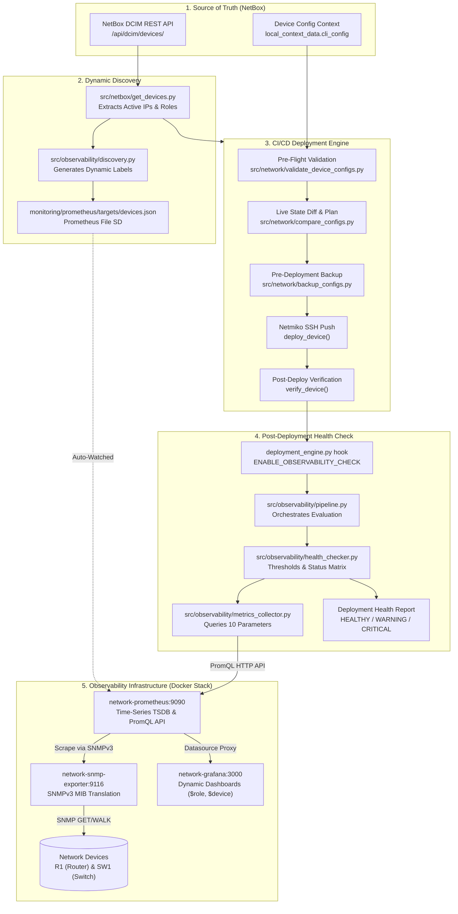

# Network CI/CD & Observability: System Architecture & End-to-End Flow

This document details the architectural blueprint and operational data flow of the Network Automation CI/CD and Observability platform.

---

## 1. High-Level Architecture Flowchart



---

## 2. The Dual-Loop System Design

The platform operates on two independent, non-interfering loops:

```text
 ┌────────────────────────────────────────────────────────────────────────┐
 │ LOOP A: CONTINUOUS 24/7 OBSERVABILITY                                  │
 │                                                                        │
 │ NetBox ──► discovery.py ──► devices.json ──► Prometheus ──► Grafana   │
 │                                                   │                    │
 │                                                   ▼                    │
 │                                            Network Devices             │
 │                                            (SNMPv3 Scrapes)            │
 └────────────────────────────────────────────────────────────────────────┘

 ┌────────────────────────────────────────────────────────────────────────┐
 │ LOOP B: EVENT-DRIVEN CI/CD DEPLOYMENT PIPELINE                         │
 │                                                                        │
 │ NetBox ──► Validation ──► Backup ──► Deploy ──► Verify ──► Health Check│
 │                                                               │        │
 │                                                               ▼        │
 │                                                         Prometheus API │
 │                                                         (Read-Only)    │
 └────────────────────────────────────────────────────────────────────────┘
```

### Loop A: Continuous 24/7 Monitoring (Background Service)
1. **Always Running**: Operates inside Docker containers independently of whether deployments are occurring.
2. **Prometheus File-Based Service Discovery (`file_sd_configs`)**:
   - Prometheus watches `/etc/prometheus/targets/*.json`.
   - When new devices are added in NetBox and `discovery.py` runs, Prometheus reloads targets dynamically **with zero downtime or restart**.
3. **Out-of-Band Telemetry**:
   - The SNMP Exporter queries devices over SNMPv3 (SHA auth, AES priv).
   - Collects uptime, CPU, memory, interface status, traffic counters, bandwidth metrics, packet errors, OSPF states, and scrape latency.
4. **Grafana Visualization**:
   - Auto-provisioned datasource connects to Prometheus.
   - Dynamic template variables (`$role`, `$device`) query Prometheus label values directly, allowing operators to monitor all devices side-by-side or isolate a single device.

### Loop B: On-Demand CI/CD Deployment Pipeline
1. **Triggered on Demand**: Run by network engineers or automated deployment triggers.
2. **Deterministic Stages**:
   - **Validation**: Checks intended VLANs, DHCP pools, and syntax rules before touching devices.
   - **Live Diff**: Extracts live device running-config over Netmiko SSH and computes missing configuration.
   - **Safety Approval**: Requires typed operator confirmation (`DEPLOY` or `DEPLOY FULL`).
   - **Pre-Deployment Backup**: Saves timestamped running-config files with restricted permissions (`0600`) to `backups/`.
   - **Deployment**: Applies configuration changes via Netmiko.
   - **Device Verification**: Verifies that intended commands are active in running-config.
3. **Post-Deployment Telemetry Verification**:
   - Once device-level verification passes, CI/CD queries Prometheus via its HTTP API.
   - Compiles live telemetry across all 10 monitoring parameters and generates the **Deployment Health Report**.

---

## 3. Strict Safety & Fault-Tolerance Guarantees

| Requirement | Architectural Mechanism |
| :--- | :--- |
| **No Hardcoded Values** | Device IPs, names, roles, and credentials are discovered from NetBox and `.env`. PromQL queries use dynamic regex selectors (`instance=~"$ip(:\\d+)?"`). |
| **Independent Failure Isolation** | If Prometheus or an exporter is down, the deployment result is **not cancelled or rolled back**. CI/CD outputs an observability warning and preserves deployment status. |
| **Graceful Capability Handling** | Different Cisco hardware models support different MIBs (e.g., R1 supports Cisco CPU/Memory MIBs; SW1 does not). Unsupported metrics are reported as `[UNSUPPORTED]` without false healthy or failure. |
| **Zero Impact on Existing CI/CD** | All existing CI/CD modules remain untouched. All 66 original tests execute with 100% backward compatibility. |
| **Secret Protection** | Passwords and tokens exist only in `.env` (ignored by git). `.env.example` provides template placeholders only. |

